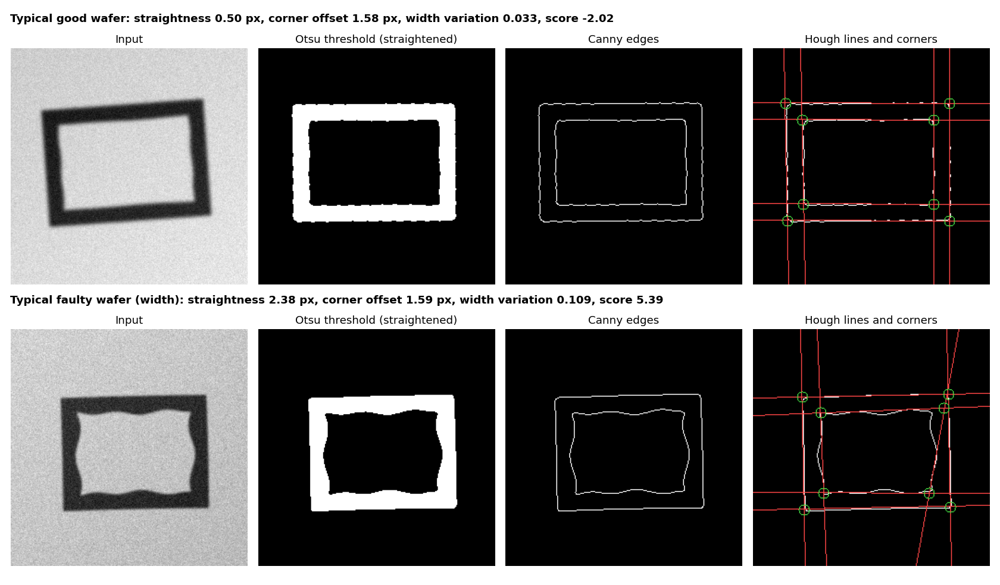
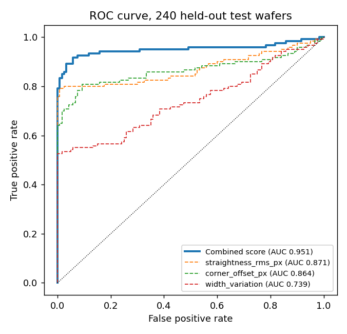
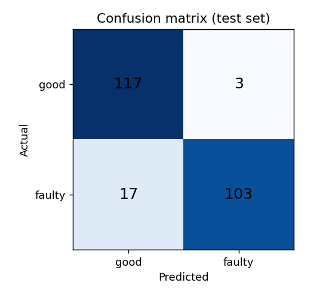
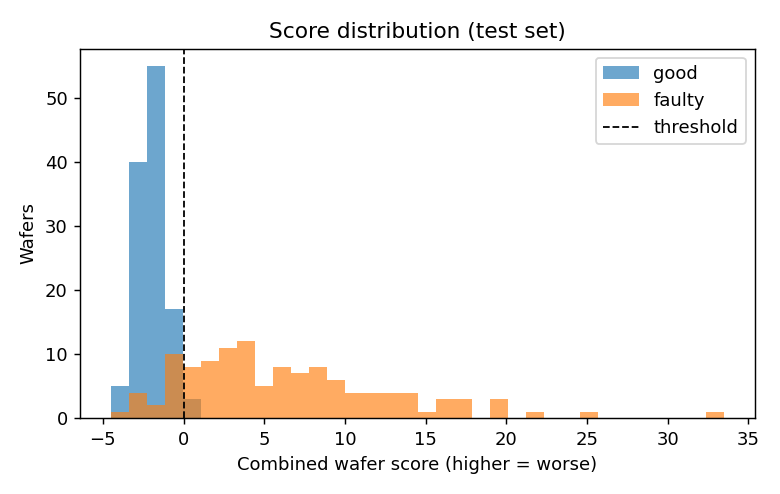
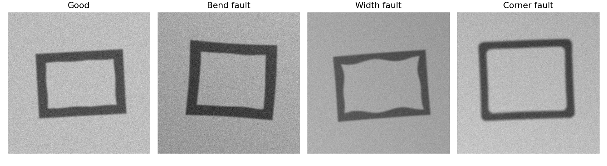

# Etched Wafer Quality Scoring

A Python pipeline that scores simulated etched wafer images for quality. It generates wafers with known, controlled faults, measures **channel straightness** and **corner squareness** with thresholding, edge detection and Hough line detection, combines the measures into **one numerical score per wafer**, and tests the score with confusion matrices and ROC curves.

> **Everything here is simulated.** No real microscope or SEM images are used, so the results describe how well the measurements detect the faults *defined in this simulator*, not real wafers.



## What it does
1. **Simulates wafers** (`wafer/simulate.py`): a rectangular etched channel with a random position, small rotation, uneven lighting, blur and noise. Three faults can be switched on, alone or together:
   - **Bent channel**: the sides bow away from straight (1.5 to 8 px)
   - **Uneven width**: the channel width varies along its length (8% to 30% of nominal)
   - **Rounded corners**: corner radius of 2.5 to 10 px instead of square

   "Good" wafers still carry tiny nominal imperfections, so the classes overlap at low fault severity.
2. **Measures each wafer** (`wafer/measure.py`):
   - Gaussian blur and Otsu threshold give a binary channel mask
   - Hough segments estimate the tilt, and the mask is straightened
   - Canny edge detection finds the channel boundaries
   - The Hough transform fits the 8 straight boundary lines, giving three measures:

   | Measure | Meaning | Sensitive to |
   |---|---|---|
   | `straightness_rms_px` | RMS distance of boundary pixels from the fitted straight lines (corner zones excluded) | bends |
   | `corner_offset_px` | mean distance from each ideal corner (where two fitted lines meet) to the nearest boundary pixel | rounded corners |
   | `width_variation` | coefficient of variation of the channel width along each side | uneven width |
3. **Combines the measures** into one score with a logistic regression on the standardised measures, fitted on training wafers only. A score above 0 means "faulty".
4. **Evaluates** on separate held-out test wafers (`run_experiment.py`).

## Results
Test set: 240 simulated wafers (120 good, 120 faulty), generated with a different seed from the 480 training wafers.

| | Main run (seed 0) | Mean over 10 seeds |
|---|---|---|
| Accuracy | 91.7% (95% bootstrap CI 87.9 to 95.0%) | 92.5% ± 2.4% (range 87.5 to 95.8%) |
| ROC AUC | 0.951 (95% CI 0.916 to 0.980) | 0.963 ± 0.016 (range 0.930 to 0.982) |

Main run confusion matrix (rows actual, columns predicted):

| | Predicted good | Predicted faulty |
|---|---|---|
| **Actual good** | 117 | 3 |
| **Actual faulty** | 17 | 103 |

| Recall by fault type (main run) | |
|---|---|
| Width only | 96.0% |
| Two or three faults | 95.7% |
| Corner only | 71.4% |
| Bend only | 70.4% |

| AUC of each measure on its own | |
|---|---|
| Straightness | 0.871 |
| Corner offset | 0.864 |
| Width variation | 0.739 |
| **Combined score** | **0.951** |

Combining the measures clearly beats any single one. Most misses are faulty wafers with a mild bend or mildly rounded corners, which overlap the nominal imperfections of good wafers by design.

<p>


</p>




## How the evaluation was kept honest
- The measurement parameters (thresholds, tolerances) were set while debugging on a separate development seed (`dev_check.py`, seed 999). The reported results use different seeds (0 to 9, with test sets from seeds 10000 to 10009), and no setting was changed after seeing them.
- Scaling and the score weights are fitted on training wafers only.
- The simulator's difficulty (fault severity ranges, noise level) is a design choice in `wafer/simulate.py`. **The accuracy numbers depend directly on it**, so compare results only against the same settings.

## Limitations
- Simulated data with a simple geometry (one rectangular ring channel). Real wafers would need real images and a re-check of every parameter.
- The measures are not perfectly separate: an uneven-width fault also wobbles the boundary, so it raises the straightness measure too.
- Bent sides can pull the fitted lines off the true edges, which makes the corner measure less reliable for strongly bent wafers. If the line fit fails, a fixed penalty value is used.
- Results come from one simulator and a small test set (240 wafers), so differences of a few percentage points are within noise.

## Run it
```bash
pip install -r requirements.txt
python run_experiment.py            # main run + 10-seed repeat, writes results/
python run_experiment.py --seeds 1  # main run only
```
Figures and `results/metrics.json` are regenerated each time. The run is deterministic for a given seed.

## Project structure
```
wafer/simulate.py   wafer image simulator with controlled faults
wafer/measure.py    thresholding, edge detection, Hough lines, the three measures
run_experiment.py   dataset generation, score fitting, evaluation and figures
dev_check.py        quick debugging check on the development seed
results/            metrics.json and figures
```

## Tech
Python, OpenCV, NumPy, scikit-learn, Matplotlib
